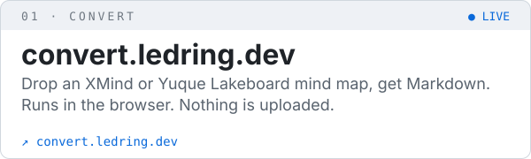
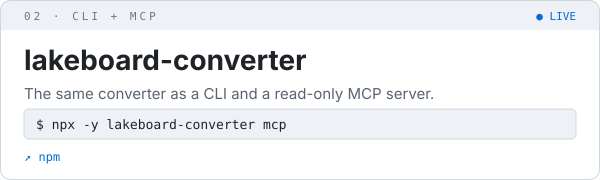
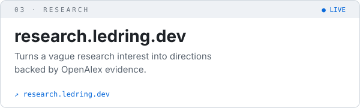
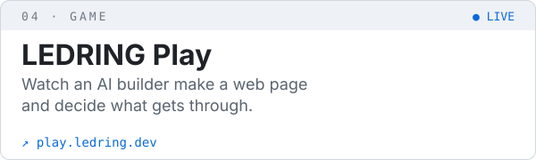
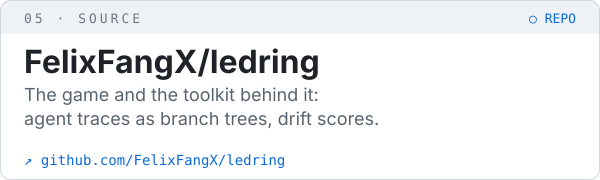
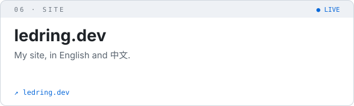
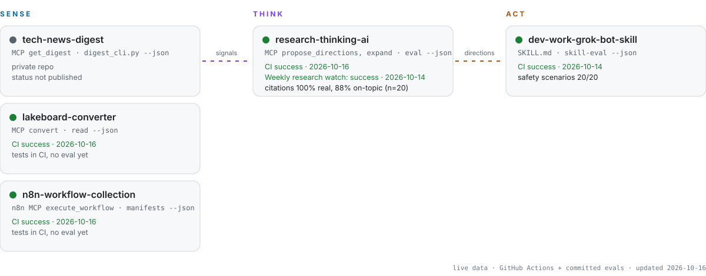

<!-- Agent Control Room v3. Assets regenerate daily via .github/workflows/control-room.yml -->

<a href="https://github.com/FelixFangX">
<picture>
  <source media="(prefers-color-scheme: dark)" srcset="./assets/hero-dark.svg">
  
</picture>
</a>

<p align="center">
  <a href="https://ledring.dev"></a>
  <br>
  <sub><b><a href="https://ledring.dev">ledring.dev</a></b> · my site · <a href="https://play.ledring.dev/play/">play LEDRING</a> · <a href="https://x.com/ColeFangX">X @ColeFangX</a></sub>
</p>

> Fast software, careful UI, open source, and an iced americano.

## Try it

I write code for humans and agents. Most of it is small and open source: a mind map converter, a research helper, and a game about reviewing what an AI builder does.

<p align="center">
  <a href="https://convert.ledring.dev"><picture><source media="(prefers-color-scheme: dark)" srcset="./assets/cards/convert-dark.svg"></picture></a>
  <a href="https://www.npmjs.com/package/lakeboard-converter"><picture><source media="(prefers-color-scheme: dark)" srcset="./assets/cards/npm-dark.svg"></picture></a>
  <br>
  <a href="https://research.ledring.dev"><picture><source media="(prefers-color-scheme: dark)" srcset="./assets/cards/research-dark.svg"></picture></a>
  <a href="https://play.ledring.dev/play/"><picture><source media="(prefers-color-scheme: dark)" srcset="./assets/cards/play-dark.svg"></picture></a>
  <br>
  <a href="https://github.com/FelixFangX/ledring"><picture><source media="(prefers-color-scheme: dark)" srcset="./assets/cards/source-dark.svg"></picture></a>
  <a href="https://ledring.dev"><picture><source media="(prefers-color-scheme: dark)" srcset="./assets/cards/site-dark.svg"></picture></a>
</p>

```sh
npx -y lakeboard-converter mcp
```

<sub><a href="https://ledring.dev">ledring.dev</a> · <a href="https://x.com/ColeFangX">X @ColeFangX</a></sub>

## ▶ Flagship: LEDRING

[](https://play.ledring.dev/play/)

**[Play LEDRING in your browser](https://play.ledring.dev/play/)**. You watch an AI builder make a web page and decide what gets through. The free built-in AI needs no key; the game is in English and Chinese (Simplified). Under the hood it is a toolkit that replays agent traces as branch trees and scores how far a run drifted from its instruction. **[Repo →](https://github.com/FelixFangX/ledring)**

## The control room

My agents run the repetitive parts of work and life. I stay in the loop where judgment matters: what to build, how to test it, and whether it actually works.

<picture>
  <source media="(prefers-color-scheme: dark)" srcset="./assets/layers-dark.svg">
  
</picture>

| Agent layer | What it takes off my plate |
|---|---|
| [**research-thinking-ai**](https://github.com/FelixFangX/research-thinking-ai) | Turns a vague research interest into evidence-tiered directions · [live](https://research.ledring.dev) |
| [**n8n-workflow-collection**](https://github.com/FelixFangX/n8n-workflow-collection) | Lark/Feishu bot messages → Bitable records and PRD drafts; social metrics tracking |
| **tech-news-digest** <sub>(private)</sub> | Papers, GitHub Trending and Stack Overflow, ranked to my interests every morning |
| [**lakeboard-converter**](https://github.com/FelixFangX/lakeboard-converter) | Yuque Lakeboard / XMind → Markdown that agents can read · [live](https://convert.ledring.dev) |
| [**dev-work-grok-bot-skill**](https://github.com/FelixFangX/dev-work-grok-bot-skill) | A Grok Bot skill that sets up a careful developer assistant: repos, tracker, team chat, preview tests, with a secret/PII checker |
| [**ledring**](https://github.com/FelixFangX/ledring) | Status lights for my agents: replays many runs as one branch tree with divergence %, and scores how far a run drifted from its instruction. Claude Code + OpenTelemetry GenAI traces |

## Live system map

<sub>Sense → think → act. Built daily from GitHub Actions runs and committed eval results only; failing runs show as failing. Agents: read [`llms.txt`](./llms.txt) or [`status.json`](./status.json).</sub>

<picture>
  <source media="(prefers-color-scheme: dark)" srcset="./assets/system-map-dark.svg">
  
</picture>

## Now building: Become Human

A personal memory layer for agents that is **portable** (plain files, any model), **private** (stays on your disk), and **correctable** (you can see and fix what it believes about you).

<picture>
  <source media="(prefers-color-scheme: dark)" srcset="./assets/status-dark.svg">
  
</picture>

## Agent log

<sub>Pulled from my public GitHub activity by a daily Action. Real events only.</sub>

<!-- agent-log:start -->
| date&nbsp;(UTC) | repo | latest commit |
|---|---|---|
| 2026-10-26 | [dashtaste](https://github.com/FelixFangX/dashtaste) | docs(cases): add finance and live gallery walkthroughs (#2) |
| 2026-10-23 | [ledring](https://github.com/FelixFangX/ledring) | feat(play-strands): add GET / and /health discovery for api.ledring.dev |
| 2026-10-20 | [research-thinking-ai](https://github.com/FelixFangX/research-thinking-ai) | eval: run llm mode on Workers AI and publish results (#22) |
| 2026-10-20 | [dev-work-grok-bot-skill](https://github.com/FelixFangX/dev-work-grok-bot-skill) | eval: first model run on Workers AI, 12/20 (#22) |
| 2026-10-20 | [lakeboard-converter](https://github.com/FelixFangX/lakeboard-converter) | 0.5.0: Markdown to XMind, batch reads and inspect (#26) |
| 2026-10-16 | [n8n-workflow-collection](https://github.com/FelixFangX/n8n-workflow-collection) | feat: split workflows into global (English) and cn (Chinese) editions (# |
<!-- agent-log:end -->

<details>
<summary><b>Tools I reach for</b></summary>

Stack I reach for: TypeScript · React/Next.js · Node · Python · n8n · Lark Open Platform · MCP · Claude Code / Codex / Cursor.
</details>

<sub>The banner scene rotates daily across focus, recovery and fun: deep work, dialogue, markets, recovery, live set, premiere. Nobody needs the same day twice.</sub>
