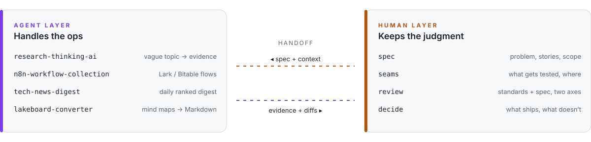
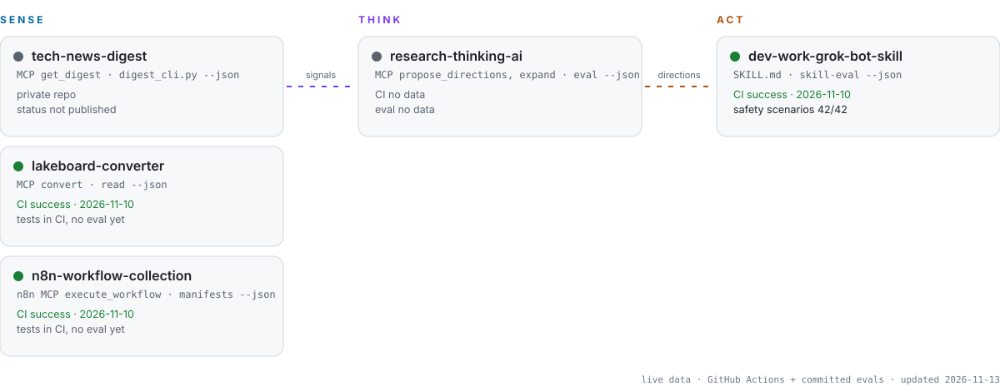

<!-- Hero SVGs and the agent log regenerate daily via .github/workflows/control-room.yml -->

<a href="https://github.com/FelixFangX">
<picture>
  <source media="(prefers-color-scheme: dark)" srcset="./assets/hero-dark.svg">
  
</picture>
</a>

<sub>The banner scene rotates daily across focus, recovery, and fun. Scene art is animated (drawing traces, equalizer, dialogue, breathing rings, a walking cat, a blinking cursor). The daily Action rewrites <code>assets/hero-light.svg</code> and <code>assets/hero-dark.svg</code>.</sub>

My agents run the ops. I keep the judgment.

> Fast software, careful UI, open source, and an iced americano.

[ledring.dev](https://ledring.dev) · [X @ColeFangX](https://x.com/ColeFangX)

## Products

**[LEDRING / Play](https://play.ledring.dev/play/)** — Review AI builders like a game: watch the branch tree, catch instruction drift.

**[maptaste](https://maptaste.ledring.dev)** — Stop agents shipping rainbow MapLibre choropleths.

```sh
npx maptaste check style.json --pack global
```

**[lakeboard-converter](https://convert.ledring.dev)** — Mind maps your agents can actually read — Lakeboard/XMind → Markdown.

```sh
npx -y lakeboard-converter mcp
```

<details>
<summary>Daily diagrams</summary>

The Action still draws these. The map uses real GitHub Actions runs and committed eval results. The status bar is set by hand. Agents can read [`llms.txt`](./llms.txt) or [`status.json`](./status.json).

<picture>
  <source media="(prefers-color-scheme: dark)" srcset="./assets/layers-dark.svg">
  
</picture>

<picture>
  <source media="(prefers-color-scheme: dark)" srcset="./assets/system-map-dark.svg">
  
</picture>

<picture>
  <source media="(prefers-color-scheme: dark)" srcset="./assets/status-dark.svg">
  
</picture>

</details>

## Agent log

<sub>Pulled from my public GitHub activity by a daily Action. Real events only.</sub>

<!-- agent-log:start -->
| date&nbsp;(UTC) | repo | latest commit |
|---|---|---|
| 2026-11-03 | [lakeboard-converter](https://github.com/FelixFangX/lakeboard-converter) | Read popular mind maps as Markdown (#31) |
| 2026-11-03 | [dashtaste](https://github.com/FelixFangX/dashtaste) | Check named dashboard tastes instead of one shared palette (#6) |
| 2026-11-03 | [maptaste](https://github.com/FelixFangX/maptaste) | Named tastes are plates, not a shared palette (#5) |
| 2026-11-03 | [dev-work-grok-bot-skill](https://github.com/FelixFangX/dev-work-grok-bot-skill) | Position the skill as a harness and add optional 2026 practice (#26) |
| 2026-11-03 | [ledring](https://github.com/FelixFangX/ledring) | Publish-ready ledring package for the public Beta (#109) |
| 2026-11-03 | [n8n-workflow-collection](https://github.com/FelixFangX/n8n-workflow-collection) | docs: note lark-cli and Grok Bot reduce need for these n8n flows |
<!-- agent-log:end -->
