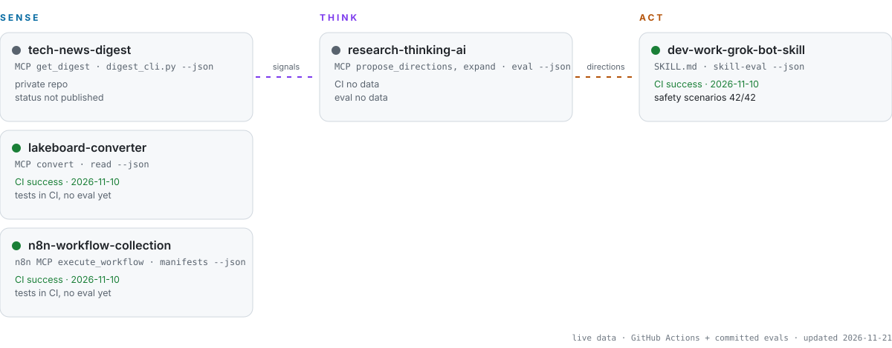

<!-- Hero SVGs, status map, and the projects table regenerate daily via .github/workflows/control-room.yml -->

<a href="https://github.com/FelixFangX">
<picture>
  <source media="(prefers-color-scheme: dark)" srcset="./assets/hero-dark.svg">
  
</picture>
</a>

<sub>The banner scene rotates daily across focus, recovery, and fun. Scene art is animated and honors <code>prefers-reduced-motion</code>. The daily Action rewrites <code>assets/hero-light.svg</code> and <code>assets/hero-dark.svg</code>.</sub>

My agents run the ops. I keep the judgment.

> Fast software, careful UI, open source, and an iced americano.

[ledring.dev](https://ledring.dev) · [Notes](https://ledring.dev/notes/) · [X @ColeFangX](https://x.com/ColeFangX)

## Products

**[maptaste](https://maptaste.ledring.dev)** — Stop agents shipping rainbow MapLibre choropleths. Six named cartographic tastes, live WebGL studio, CLI, MCP, and Agent Skills. ([repo](https://github.com/FelixFangX/maptaste))

```sh
npx maptaste check style.json --taste ink-paper
```

**[dashtaste](https://dashtaste.ledring.dev)** — Stop agents shipping rainbow ECharts dashboards. 38 rules, six named tastes (global & CN), CLI, MCP, and Agent Skills. ([repo](https://github.com/FelixFangX/dashtaste))

```sh
npx dashtaste check dashboard.json --taste saas-dense
```

**[LEDRING / Play](https://play.ledring.dev/play/)** — Review AI builders like a game: watch the branch tree, catch instruction drift, and detect Red Wall workarounds (`npm install -g ledring@beta` for the trace CLI). ([repo](https://github.com/FelixFangX/ledring))

**[lakeboard-converter](https://convert.ledring.dev)** — Mind maps your agents can actually read: 9 formats (Lakeboard, XMind, OPML, FreeMind, MindManager…) → Markdown, local-first in the browser or via MCP. ([repo](https://github.com/FelixFangX/lakeboard-converter))

```sh
npx -y lakeboard-converter mcp
```

<sub>Upstream open-source fixes merged in <a href="https://github.com/nuxt/nuxt">nuxt/nuxt</a>, <a href="https://github.com/nitrojs/nitro">nitrojs/nitro</a>, and <a href="https://github.com/ueberdosis/tiptap">ueberdosis/tiptap</a>.</sub>

## Public repos

<sub>Rewritten daily from the public GitHub API in the order listed in <code>src/system.mjs</code>. Dates are the latest commit on each repo's default branch.</sub>

<!-- projects:start -->
| repo | description | latest commit (UTC) |
|---|---|---|
| [maptaste](https://github.com/FelixFangX/maptaste) | Stop agents shipping rainbow MapLibre choropleths. | 2026-11-10 |
| [dashtaste](https://github.com/FelixFangX/dashtaste) | Stop agents shipping rainbow ECharts dashboards. | 2026-11-10 |
| [ledring](https://github.com/FelixFangX/ledring) | Review AI builders like a game: watch the branch tree, catch instruction drift. | 2026-11-10 |
| [lakeboard-converter](https://github.com/FelixFangX/lakeboard-converter) | Mind maps your agents can actually read — Lakeboard/XMind → Markdown. | 2026-11-10 |
| [dev-work-grok-bot-skill](https://github.com/FelixFangX/dev-work-grok-bot-skill) | Turn a Grok Bot into a safe work assistant for your product. | 2026-11-10 |
| [ledring.dev](https://github.com/FelixFangX/ledring.dev) | ledring.dev — status lights for AI agents + Play. | 2026-11-03 |
<!-- projects:end -->

<details>
<summary>How the work is split &amp; live status</summary>

The Action draws these from public GitHub Actions runs and committed eval files. Missing data renders as "no data". Agents can read [`llms.txt`](./llms.txt) or [`status.json`](./status.json).

<picture>
  <source media="(prefers-color-scheme: dark)" srcset="./assets/layers-dark.svg">
  
</picture>

<picture>
  <source media="(prefers-color-scheme: dark)" srcset="./assets/system-map-dark.svg">
  
</picture>

</details>
