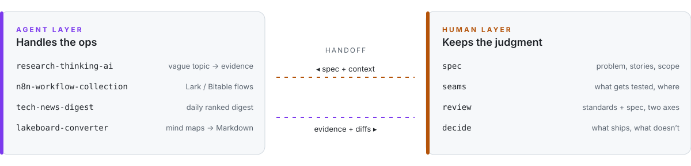
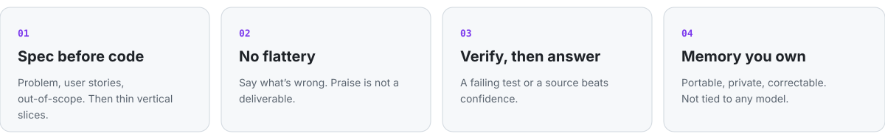

<!-- Agent Control Room v3. Assets regenerate daily via .github/workflows/control-room.yml -->
<a href="https://github.com/FelixFangX">
<picture>
  <source media="(prefers-color-scheme: dark)" srcset="./assets/hero-dark.svg">
  
</picture>
</a>

> *Man, I don't even know how I'd function without AI.* So I made it work properly: specs instead of vibes, evidence instead of flattery, memory I own instead of memory a vendor owns.

## The control room

My agents run the repetitive parts of work and life. I stay in the loop where judgment matters: what to build, how to test it, and whether it actually works.

<picture>
  <source media="(prefers-color-scheme: dark)" srcset="./assets/layers-dark.svg">
  
</picture>

| Agent layer | What it takes off my plate |
|---|---|
| [**research-thinking-ai**](https://github.com/FelixFangX/research-thinking-ai) | Turns a vague research interest into evidence-tiered directions · [live](https://research-thinking-ai.vercel.app) |
| [**n8n-workflow-collection**](https://github.com/FelixFangX/n8n-workflow-collection) | Lark/Feishu bot messages → Bitable records and PRD drafts; social metrics tracking |
| [**tech-news-digest**](https://github.com/FelixFangX/tech-news-digest) | Papers, GitHub Trending and Stack Overflow, ranked to my interests every morning |
| [**lakeboard-converter**](https://github.com/FelixFangX/lakeboard-converter) | Yuque Lakeboard / XMind → Markdown that agents can read |
| [**dev-work-grok-bot-skill**](https://github.com/FelixFangX/dev-work-grok-bot-skill) | A Grok Bot skill that sets up a careful developer assistant: repos, tracker, team chat, preview tests, with a secret/PII checker |

## Operating principles

<picture>
  <source media="(prefers-color-scheme: dark)" srcset="./assets/principles-dark.svg">
  
</picture>

## Now building: Become Human

A personal memory layer for agents that is **portable** (plain files, any model), **private** (stays on your disk), and **correctable** (you can see and fix what it believes about you).

<picture>
  <source media="(prefers-color-scheme: dark)" srcset="./assets/status-dark.svg">
  
</picture>

## Agent log

<sub>Pulled from my public GitHub activity by a daily Action. Real events only.</sub>

<!-- agent-log:start -->
| date&nbsp;(UTC) | repo | latest commit |
|---|---|---|
| 2026-10-13 | [agent-memory-vault](https://github.com/FelixFangX/agent-memory-vault) | docs: Control Room README + CI on Node 20/22 (#9) |
| 2026-10-13 | [tech-news-digest](https://github.com/FelixFangX/tech-news-digest) | chore: remove obsolete repair_0511 script |
| 2026-10-13 | [research-thinking-ai](https://github.com/FelixFangX/research-thinking-ai) | ci: pin pnpm major version |
| 2026-10-13 | [n8n-workflow-collection](https://github.com/FelixFangX/n8n-workflow-collection) | ci: explicit test glob for Node 22 |
| 2026-10-13 | [lakeboard-converter](https://github.com/FelixFangX/lakeboard-converter) | ci: run tests on push and pull requests |
| 2026-09-04 | [fitness-guide](https://github.com/FelixFangX/fitness-guide) | ci: use pnpm in github actions |
<!-- agent-log:end -->

<details>
<summary><b>How I build with agents</b></summary>

```text
spec    problem, user stories, out-of-scope; written before any code
slice   tracer-bullet tickets, each demoable in one agent session
test    red → green at agreed seams; LLMs and APIs behind adapters
review  two axes: does it follow the standards, does it match the spec
```

Stack I reach for: TypeScript · React/Next.js · Node · Python · n8n · Lark Open Platform · MCP · Claude Code / Codex / Cursor.
I learn by building and by arguing with docs, so most of what's here started as a practice project.
</details>

<sub>The banner scene rotates daily across focus, recovery and fun: deep work, dialogue, markets, recovery, live set, premiere. Nobody needs the same day twice.</sub>
