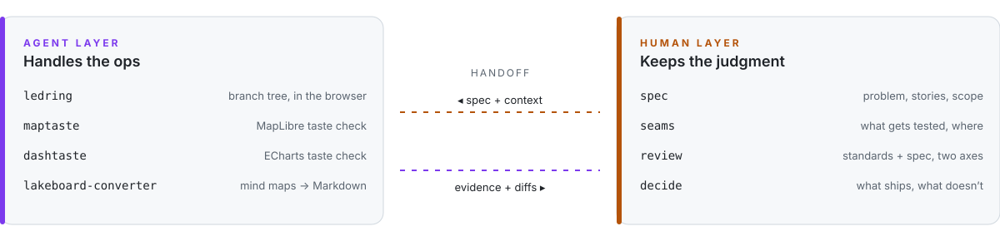

<!-- Hero SVGs and the public-repo table regenerate daily via .github/workflows/control-room.yml -->

<a href="https://github.com/FelixFangX">
<picture>
  <source media="(prefers-color-scheme: dark)" srcset="./assets/hero-dark.svg">
  
</picture>
</a>

<sub>The banner scene rotates daily across focus, recovery, and fun. Scene art is animated (drawing traces, equalizer, dialogue, breathing rings, a walking cat, a blinking cursor). The daily Action rewrites <code>assets/hero-light.svg</code> and <code>assets/hero-dark.svg</code>. That rotation is not a new commit on the projects below. The <code>$</code> line dates the latest public commit.</sub>

My agents run the ops. I keep the judgment.

> Fast software, careful UI, open source, and an iced americano.

[ledring.dev](https://ledring.dev) · [X @ColeFangX](https://x.com/ColeFangX)

## Try these

Public tools. The browser ones need no install. The CLIs need Node 20 or newer.

**[LEDRING / Play](https://play.ledring.dev/play/)** — Press Start, watch an AI write one page, and stop it when it leaves the instruction. The default AI needs no key and no sign-up; it shares a daily quota. The built-in demo makes no AI calls. There are 7 endings, judged from the file that was written. English and Chinese (Simplified): [`?lang=zh`](https://play.ledring.dev/play/?lang=zh).

The trace CLI is a separate beta, `npm install -g ledring@beta`. It draws a branch tree from Claude Code or OpenTelemetry GenAI traces. That package does not include the local Play bridge. Source: [FelixFangX/ledring](https://github.com/FelixFangX/ledring).

**[maptaste](https://maptaste.ledring.dev)** — Check a MapLibre style against a named taste before it ships as a rainbow choropleth. The demo needs WebGL and a network connection for the tiles.

```sh
npx maptaste check style.json --taste ink-paper
```

`--pack global` is that same taste. The score is a heuristic: it is not a MapLibre validation, and the checker never sees the rendered map. Early 0.x; thresholds can change in any 0.x release. Source: [FelixFangX/maptaste](https://github.com/FelixFangX/maptaste).

**[dashtaste](https://dashtaste.ledring.dev)** — The same kind of check for an ECharts dashboard. Numbers in the gallery are fictional samples.

```sh
npx dashtaste check dashboard.json --taste saas-dense
```

A score of 100 on an empty chart list means no charts were reviewed. Early 0.x; rules can change in any 0.x release. Source: [FelixFangX/dashtaste](https://github.com/FelixFangX/dashtaste).

**[lakeboard-converter](https://convert.ledring.dev)** — Drop a Yuque Lakeboard or XMind file in the browser and get Markdown. The file stays on your machine. Styles, layout, and icons are omitted. The native MindNode package is not read; export OPML. The CLI wants Node 20.12 or newer.

```sh
npx -y lakeboard-converter mcp
```

Also reads OPML, FreeMind, MindManager, iThoughts, SimpleMind, and a CSV outline. `from_markdown` can write an `.xmind` at a path you pass; the other MCP tools are read-only. English and Chinese (Simplified) in the repo README. Source: [FelixFangX/lakeboard-converter](https://github.com/FelixFangX/lakeboard-converter).

**[dev-work-grok-bot-skill](https://github.com/FelixFangX/dev-work-grok-bot-skill)** — Copy [`skills/dev-work-bot-setup/SKILL.md`](https://github.com/FelixFangX/dev-work-grok-bot-skill/blob/main/skills/dev-work-bot-setup/SKILL.md) into a Grok Bot so it stops before a send, a push, or a pasted secret. The published coverage check is 42/42 rule strings still present in the file. That does not show that a model follows them. One published model run, on 2026-10-20, scored 12/20. The repo says that run does not prove immunity.

## Also public

**[n8n-workflow-collection](https://github.com/FelixFangX/n8n-workflow-collection)** — Redacted n8n exports for Lark/Bitable and social metrics. The README says to skip this if you already use lark-cli plus an agent. `npm run preflight` only reads the files. It does not call n8n, Lark, or Apify, and exit 0 is not a production certification. A Chinese (Simplified) edition is in the repo.

**[ledring.dev](https://github.com/FelixFangX/ledring.dev)** — Source for [ledring.dev](https://ledring.dev).

## Public repos

<sub>The daily Action rewrites this table from the public GitHub API, in the order listed in <code>src/system.mjs</code>. The date is the latest commit on the default branch. It stays put until that commit changes.</sub>

<!-- projects:start -->
| repo | description | latest commit (UTC) |
|---|---|---|
| [ledring](https://github.com/FelixFangX/ledring) | Review AI builders like a game: watch the branch tree, catch instruction drift. | 2026-11-10 |
| [maptaste](https://github.com/FelixFangX/maptaste) | Stop agents shipping rainbow MapLibre choropleths. | 2026-11-10 |
| [dashtaste](https://github.com/FelixFangX/dashtaste) | Stop agents shipping rainbow ECharts dashboards. | 2026-11-10 |
| [lakeboard-converter](https://github.com/FelixFangX/lakeboard-converter) | Mind maps your agents can actually read — Lakeboard/XMind → Markdown. | 2026-11-10 |
| [dev-work-grok-bot-skill](https://github.com/FelixFangX/dev-work-grok-bot-skill) | Turn a Grok Bot into a safe work assistant for your product. | 2026-11-10 |
| [n8n-workflow-collection](https://github.com/FelixFangX/n8n-workflow-collection) | Import-ready n8n: Lark→Bitable PRDs + social metrics. Prefer lark-cli + Grok Bot for new work. | 2026-11-10 |
| [ledring.dev](https://github.com/FelixFangX/ledring.dev) | ledring.dev — status lights for AI agents + Play. | 2026-11-03 |
<!-- projects:end -->

<details>
<summary>How the work is split</summary>

An illustration, not a status board. The names in it are public repos.

<picture>
  <source media="(prefers-color-scheme: dark)" srcset="./assets/layers-dark.svg">
  
</picture>

</details>

Agents: [`llms.txt`](./llms.txt) and [`status.json`](./status.json) list these public repos only.
